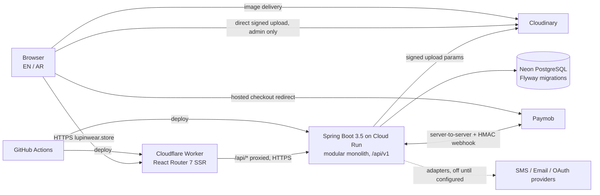

# Architecture

## System



**Same-origin API.** The Worker forwards `/api/*` to the backend, so the browser only ever talks to `lupinwear.store`. Auth cookies are first-party (`SameSite=Lax`, `HttpOnly`, `Secure`), no third-party-cookie problems on Safari, and CORS stays closed apart from an explicit allowlist for local development. During SSR the Worker calls the backend directly and forwards the visitor's cookies.

## Backend modules

Package root `store.lupinwear`. Each module owns its tables and exposes a small service API; other modules never touch its repositories.

```
shared/        errors, pagination, money, clock, i18n text, web config
security/      filter chain, JWT, cookies, CSRF, rate limiting
auth/          users, roles, sessions (refresh tokens), login attempts, reset/verify tokens
customer/      profiles, addresses
catalog/       departments, categories, products, colours, sizes, variants, images, collections
inventory/     stock levels, movements, reservations
cart/          carts, items
favorites/
promotion/     offers, promo codes, redemptions, pricing rules
delivery/      governorates, zones, options, quotes, shipments
checkout/      pricing engine (single source of truth for totals)
order/         orders, items, state machine, cancellation + undo
payment/       PaymentProvider SPI, Paymob adapter, COD, manual transfer, webhook inbox
review/        reviews + moderation
content/       site settings, home sections, FAQ, policies
media/         Cloudinary signing
notification/  email/SMS/WhatsApp-link SPI
audit/         append-only audit log
admin/         dashboard read models, reports, CSV
```

Layers inside a module: `api` (controllers + DTOs) → `application` (services, transactions) → `domain` (entities, rules) → `infra` (repositories, external clients). Controllers hold no logic; entities never leave the service layer.

## Auth design

- Access token: signed JWT (HS256, server secret), **15 min**, in `lw_at` HttpOnly cookie.
- Refresh token: 256-bit random, stored **hashed** (SHA-256) in `auth_sessions`, **30 days**, cookie `lw_rt` scoped to `Path=/api/v1/auth`. Rotated on every use; presenting an already-rotated token revokes the whole session family.
- CSRF: double-submit cookie `XSRF-TOKEN` + `X-XSRF-TOKEN` header on every state-changing request. The Paymob webhook is exempt and authenticated by HMAC instead.
- Passwords: Argon2id. Minimum 10 characters for customers, 12 for staff.
- Brute force: per-account lockout with growing delay, plus per-IP and per-identifier rate limits on login, register, reset and OTP.
- Roles: `CUSTOMER`, `ADMIN`, `OWNER`; fine-grained permissions on roles; `@PreAuthorize` on every admin endpoint, in addition to the `/api/v1/admin/**` URL rule.

## Order and payment state

```mermaid
stateDiagram-v2
  [*] --> PENDING: order created, stock reserved
  PENDING --> AWAITING_PAYMENT: online / transfer method chosen
  PENDING --> CONFIRMED: cash on delivery accepted
  AWAITING_PAYMENT --> PAID: verified webhook or admin-verified transfer
  PAID --> CONFIRMED
  CONFIRMED --> PROCESSING --> SHIPPED --> DELIVERED
  PENDING --> CANCELLED
  AWAITING_PAYMENT --> CANCELLED
  PAID --> CANCELLED
  CONFIRMED --> CANCELLED
  PROCESSING --> CANCELLED: staff only
  CANCELLED --> PENDING: undo within window, stock re-reserved
  CANCELLED --> REFUNDED
  DELIVERED --> REFUNDED
```

Payment status is separate: `NOT_REQUIRED`, `PENDING`, `VERIFYING` (manual transfer), `PAID`, `FAILED`, `REFUND_PENDING`, `REFUNDED`, `PARTIALLY_REFUNDED`. Undo is only possible while no refund has been started and the configurable window (default 30 min) is open; stock must still be available.

## Stock safety

`UPDATE inventory SET reserved = reserved + :q WHERE variant_id = :v AND on_hand - reserved >= :q` — one atomic statement per line, inside the order transaction, backed by `CHECK (reserved <= on_hand)`. Zero rows updated means sold out; the whole order rolls back. Every change writes an `inventory_movements` row.

## Frontend

React Router 7 framework mode on Cloudflare Workers (`@cloudflare/vite-plugin`), Tailwind 4, TanStack Query for client-side state that changes after load (bag, favourites, account), loaders for SEO pages.

```
app/
  routes/            ($lang).* storefront, admin.* dashboard (separate layout, noindex, client-rendered data)
  components/        ui/ (buttons, fields), layout/, product/, …
  features/          auth, bag, catalog, checkout, …  (api + hooks + components per feature)
  lib/               api client, i18n, money, seo
  styles/            tokens + tailwind
```

URLs: English at `/…`, Arabic at `/ar/…`, with `hreflang` alternates and `dir="rtl"`. Layout uses CSS logical properties so RTL needs no duplicated styles.
