# Database ERD

Source of truth: `backend/src/main/resources/db/migration/V1__baseline_schema.sql`. Money is `numeric(12,2)` EGP; times are `timestamptz`.

```mermaid
erDiagram
  users ||--o{ user_roles : has
  roles ||--o{ user_roles : ""
  roles ||--o{ role_permissions : ""
  permissions ||--o{ role_permissions : ""
  users ||--o{ auth_sessions : "refresh tokens"
  users ||--o{ auth_tokens : "verify / reset / otp"
  users ||--o{ oauth_identities : ""
  users ||--o| customer_profiles : ""
  users ||--o{ customer_addresses : ""
  governorates ||--o{ customer_addresses : ""

  departments ||--o{ categories : ""
  categories ||--o{ categories : "parent"
  departments ||--o{ products : ""
  categories ||--o{ products : ""
  collections ||--o{ products : ""
  products ||--o{ product_colors : ""
  product_colors ||--o{ product_images : "max 10"
  products ||--o{ product_variants : ""
  product_colors ||--o{ product_variants : ""
  sizes ||--o{ product_variants : ""
  product_variants ||--|| inventory : ""
  product_variants ||--o{ inventory_movements : ""

  users ||--o| carts : ""
  carts ||--o{ cart_items : ""
  product_variants ||--o{ cart_items : ""
  users ||--o{ favorites : ""
  products ||--o{ favorites : ""

  promotions ||--o{ promotion_targets : ""
  promotions ||--o| promo_codes : ""
  promo_codes ||--o{ promo_code_redemptions : ""

  delivery_zones ||--o{ governorates : ""
  delivery_options ||--o{ delivery_option_governorates : ""
  governorates ||--o{ delivery_option_governorates : ""

  users ||--o{ orders : places
  orders ||--o{ order_items : "price/name/size/colour snapshots"
  orders ||--o{ order_status_history : ""
  orders ||--o| promo_code_redemptions : ""
  orders ||--o{ payments : ""
  payments ||--o{ payment_events : "webhook inbox"
  payments ||--o{ refunds : ""
  orders ||--o{ shipments : ""
  order_items ||--o| reviews : "verified purchase"
  products ||--o{ reviews : ""

  users ||--o{ audit_logs : actor
```

Standalone: `faq_items`, `policies`, `site_settings`.

## Rules enforced by the database

| Rule | Constraint |
|---|---|
| A variant is product + colour + size | `unique (product_id, color_id, size_id)` |
| Never sell more than exists | `check (reserved <= on_hand)`, both `>= 0` |
| At most 10 photos per colour | `position between 0 and 9` + `unique (color_id, position)` |
| One main colour per product | partial unique index `where is_main` |
| Discount price below price | `check (sale_price < price)` |
| Order total is consistent | `check (total = subtotal - discount_total + delivery_fee)` |
| A webhook is processed once | `unique (provider, event_key)` on `payment_events` |
| A provider transaction pays one payment | partial unique index on `(provider, provider_transaction_id)` |
| One promo redemption per order | `unique (order_id)`; usage limit `check (redeemed_count <= max_redemptions)` |
| One review per purchased item | `unique (order_item_id)` |
| A policy cannot be published unapproved | `check (status = 'DRAFT' or approved_by is not null)` |
| Emails are unique, case-insensitively | stored lower-case (`check`) + unique index |
| One default address per customer | partial unique index `where is_default` |

Soft deletion: `users.deleted_at`, `products.deleted_at` (+ `ARCHIVED`). Order items keep snapshots and survive product deletion (`on delete set null`).
